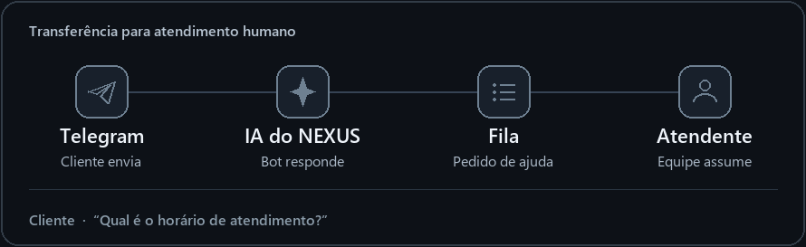
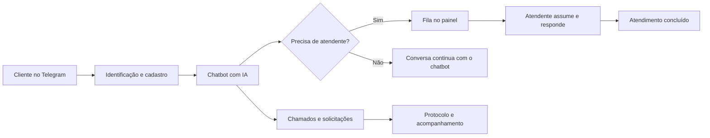

<div align="center">

# NEXUS

### Atendimento inteligente que continua com pessoas

Uma plataforma acadêmica que conecta clientes, IA e atendentes em uma mesma jornada de atendimento.



[**Acessar o NEXUS**](https://projetos-3.onrender.com/) · [Funcionalidades](#o-que-a-entrega-inclui) · [Como executar](#executar-localmente) · [Documentação](#documentação)

    

</div>

---

## Sobre o projeto

O NEXUS organiza o atendimento desde a primeira mensagem até a conclusão da conversa. O cliente inicia o contato pelo Telegram, o chatbot responde com apoio dos documentos cadastrados e a equipe acompanha a jornada em um painel web.

Quando a conversa precisa de uma pessoa, ela é encaminhada para a fila. O atendente assume a conversa com acesso ao histórico e continua o atendimento pelo painel.

> Projeto acadêmico desenvolvido em Java e Spring Boot, com orientação a objetos, persistência e integração entre camadas.

## A jornada de atendimento



## O que a entrega inclui

| Épico | Fluxos disponíveis |
| --- | --- |
| 1 — Conversas e IA | Cadastro no Telegram, triagem, respostas com documentos da empresa via Spring AI e Groq, histórico, fontes, resumo e transferência para atendimento humano. O painel permite assumir, responder, concluir e arquivar conversas. [Atendimento humano](docs/atendimento-humano.md) · [Respostas fundamentadas](docs/respostas-fundamentadas.md) |
| 2 — Consultas e solicitações | Consulta de protocolos e de planos fictícios pelo Telegram, abertura de chamados de suporte, notificação da equipe, pedidos de orçamento e pedidos de demonstração, reunião ou visita. A equipe acompanha as solicitações pelo painel. [Guias de solicitações](docs/solicitacoes-idempotentes-e-pedidos.md) · [Pedido de orçamento](docs/pedido-orcamento.md) |
| 3 — Identificação e operação | Identificação pelo contato compartilhado, validação por código para consulta de planos, acesso por perfil e empresa, administração de atendentes, registro de leads e vínculo explícito com conversas. [Identificação no Telegram](docs/identificacao-cadastro-telegram.md) · [Leads](docs/leads-atendimento.md) |

Telegram é o canal adotado pelo grupo. Planos e serviços usam dados de demonstração e os leads ficam no próprio NEXUS. A configuração de expediente orienta o encaminhamento humano. A lista de assuntos automáticos ainda precisa ser ligada à decisão de responder ou encaminhar.

## Executar localmente

Requisitos: Java 21, PostgreSQL e acesso ao banco configurado. Da raiz do repositório, entre em `chatbot`, prepare um `.env` local a partir de `.env.example` caso ainda não tenha um e preencha `DB_URL`, `DB_USER` e `DB_PASSWORD`. Para Neon, use uma URL JDBC com `sslmode=require`.

```powershell
cd chatbot
$env:SPRING_CONFIG_IMPORT = 'file:.env[.properties]'
.\mvnw.cmd spring-boot:run
```

Abra a home em `http://localhost:8080/` e use uma conta ativa em `/entrar`. O painel atende em `/painel`. O perfil padrão usa autenticação. Em um banco sem credenciais, o [bootstrap do administrador](docs/administracao-atendentes.md#primeira-credencial-administrativa) cria a primeira senha para um administrador ativo já cadastrado.

Para alterar a home em React, execute `npm ci` e `npm run build` em `chatbot/abertura`. O Vite gera os arquivos em `chatbot/src/main/resources/static/abertura`, que o Spring Boot e o Docker usam para servir a página.

## Tecnologias

| Camada | Tecnologias |
| --- | --- |
| Backend | Java 21, Spring Boot, Spring Web MVC, Spring Data JPA e Spring Security |
| Inteligência artificial | Spring AI e API da Groq |
| Dados | PostgreSQL, Neon e migrações Flyway |
| Interface | React, Vite, Framer Motion, HTML, CSS e JavaScript |
| Canal | API do Telegram com recebimento por polling |
| Testes e publicação | JUnit, Mockito, H2, Maven Wrapper, Docker e Render |

## Configurar as integrações

- **Telegram**. Configure `TELEGRAM_BOT_TOKEN`, `TELEGRAM_EMPRESA_ID` e `TELEGRAM_CHATBOT_ID`. O chatbot deve estar ativo na empresa informada. Ative `TELEGRAM_POLLING_ENABLED=true` em uma instância por token. [Configuração do Telegram](docs/telegram.md)
- **Groq**. Configure `GROQ_API_KEY` e um `GROQ_MODEL` habilitado na conta. Cadastre documentos na base de conhecimento da empresa para testar respostas e fontes. [Documentos de conhecimento](docs/documentos-conhecimento.md)
- **Verificação por e-mail**. Configure as variáveis `SMTP_*` e um endereço confiável para testar `/validar` e `/planos`. O comando `/solicitacoes` usa o cadastro concluído e o vínculo com a conta Telegram. [Regras da consulta](docs/consulta-solicitacoes-telegram.md)

O serviço do Render usa o Dockerfile de `chatbot`, aplica migrações Flyway e verifica `/actuator/health`. Forneça as variáveis e os segredos pelo ambiente de execução. Use o perfil padrão na publicação.

## Comandos do Telegram

| Comando | Função |
| --- | --- |
| `/menu` | Abre as opções de atendimento. |
| `/suporte` e `/comercial` | Identificam o tipo de atendimento. |
| `/atendente` | Solicita atendimento humano. |
| `/chamado` e `/orcamento` | Iniciam um chamado ou pedido de orçamento. |
| `/demonstracao`, `/reuniao` e `/visita` | Registram pedidos para a equipe analisar. |
| `/solicitacoes` e `/planos` | Consultam solicitações e planos disponíveis. |
| `/validar` e `/codigo` | Iniciam e concluem a validação por e-mail. |
| `/cancelar` e `/encerrar` | Cancelam um pedido em andamento ou encerram a conversa. |

## Validação da entrega

Em `chatbot`, execute:

```powershell
.\mvnw.cmd clean verify
```

A suíte usa H2 e integrações simuladas por padrão. O projeto também possui testes opt-in que chamam a Groq. Para validar a implantação com dados fictícios em ambiente autorizado:

1. Entre no painel e confira o perfil e a empresa da conta.
2. No Telegram, compartilhe o contato, pergunte algo coberto por um documento e confira a fonte no painel.
3. Peça um atendente, assuma, responda e conclua. Envie nova mensagem para confirmar a volta ao atendimento automático.
4. Abra um chamado, confira o protocolo no Telegram e a notificação no painel. Teste também orçamento, agendamento e `/solicitacoes`.
5. Se houver SMTP e e-mail confiável configurados, teste `/validar` e `/planos`.

## Estrutura

- `chatbot/src/main/java/com/wxn/chatbot` contém o domínio, os repositórios, os serviços, as APIs e as integrações com Telegram e Groq.
- `chatbot/src/main/resources/db/migration` contém as migrações Flyway.
- `chatbot/src/main/resources/static` contém o painel e os arquivos publicados da home. O código React da home fica em `chatbot/abertura`.
- `chatbot/src/test` contém os testes de domínio, persistência, API e integração.
- `docs` contém as decisões e os contratos da equipe, incluindo o [modelo de classes](docs/modelo-de-classes.md) e a [API da fila](docs/api-fila.md).

## Documentação

- [Modelo de classes](docs/modelo-de-classes.md) e [API da fila](docs/api-fila.md)
- [Atendimento humano](docs/atendimento-humano.md) e [respostas fundamentadas](docs/respostas-fundamentadas.md)
- [Abertura de chamados](docs/abertura-chamado.md) e [pedido de orçamento](docs/pedido-orcamento.md)
- [Administração de atendentes](docs/administracao-atendentes.md) e [isolamento por empresa](docs/isolamento-empresa.md)
- [Guias e decisões da equipe](docs/)

## Equipe

- João Carlos Mafra
- Arthur Almeida
- Gabriel Malta
- Márcio Rodriguez
- Gabriel Mendes
- Pedro Martins
- Hélio de Moraes
- Guilherme Guimarães
