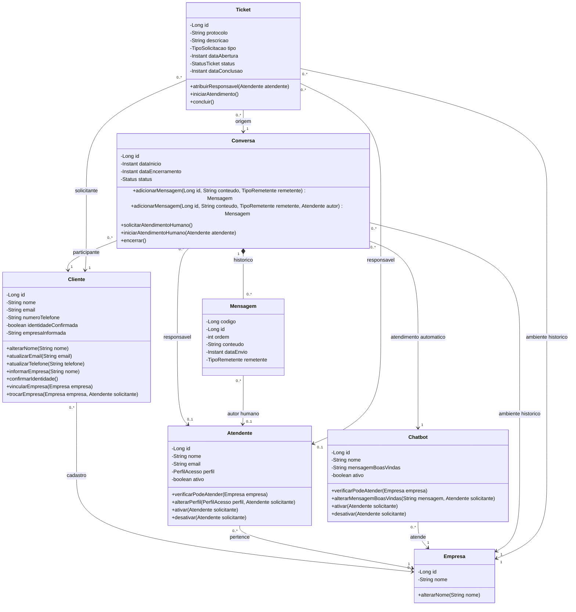

# Modelo de classes do Chatbot WXN

Representa as classes implementadas em `chatbot/src/main/java/com/wxn/chatbot/model`.
O diagrama usa Mermaid, visualizável diretamente no GitHub. Para facilitar a
leitura, apresenta os principais métodos; getters, construtores e validações
auxiliares foram omitidos. As associações representam referências entre objetos,
sem exigir listas inversas em todas as classes.

## Classes e relacionamentos

`1` significa obrigatório; `0..1`, opcional; `0..*`, zero ou muitos.
A composição entre conversa e mensagem expressa que a mensagem pertence àquela
conversa. Ela não indica exclusão em cascata: o mapeamento atual propaga apenas
persistência e atualização das mensagens.

## Valores dos enumeradores

| Enumerador | Valores |
| --- | --- |
| Atendente.PerfilAcesso | ADMINISTRADOR, COORDENADOR, ATENDENTE |
| Conversa.Status | EM_ATENDIMENTO_AUTOMATICO, AGUARDANDO_ATENDENTE, EM_ATENDIMENTO_HUMANO, ENCERRADA |
| Mensagem.TipoRemetente | CLIENTE, CHATBOT, ATENDENTE |
| Ticket.TipoSolicitacao | SUPORTE, ORCAMENTO, DEMONSTRACAO, REUNIAO, VISITA_TECNICA |
| Ticket.StatusTicket | PENDENTE, EM_ATENDIMENTO, CONCLUIDO |

## Encapsulamento e regras

- Os atributos são privados. Alterações passam pelos métodos do domínio,
  que validam dados, responsáveis e transições de estado.
- Um cliente pode começar sem empresa cadastrada. `empresaInformada` é um
  texto fornecido pelo usuário e não concede vínculo ou acesso à empresa.
- Conversa e ticket mantêm a empresa de origem, mesmo que o cadastro do cliente mude.
- Atendentes responsáveis precisam estar ativos e pertencer à empresa do atendimento.
- A conversa começa em atendimento automático, pode aguardar um atendente e
  passar ao atendimento humano. Pode ser encerrada em qualquer estado aberto.
- Mensagens não podem ser adicionadas após o encerramento. A mensagem humana
  exige o autor responsável; o chatbot só responde no estado automático.
- `getMensagens()` devolve uma cópia não modificável da lista.
- Ticket começa pendente, exige responsável para iniciar atendimento e só pode
  ser concluído após iniciar. Concluir um ticket não encerra a conversa.
- Um ticket concluído não pode receber outro responsável nem ser reaberto pelos métodos atuais.

## Persistência

Todas as sete classes são entidades JPA. Construtores sem argumentos protegidos
permitem que o JPA recarregue os objetos; a criação pela aplicação usa os
construtores públicos com validações. Os atributos antes `final` de Ticket
permanecem sem setters, com colunas de origem que não são atualizadas pelo JPA.

| Classe | Tabela | Migração |
| --- | --- | --- |
| Empresa | empresas | V1 |
| Cliente | clientes | V1 |
| Atendente | atendentes | V1 |
| Chatbot | chatbots | V1 |
| Conversa | conversas | V1 |
| Mensagem | mensagens | V2 |
| Ticket | tickets | V3 |

`Mensagem.codigo` é gerado pelo banco. Seu `id` é único dentro de uma conversa.
Os IDs das demais entidades são fornecidos pela aplicação. A tabela de tickets
valida tipo e coerência entre status, responsável e data de conclusão; as regras
de atividade e pertencimento do atendente são verificadas pelos métodos Java.

`ConversaRepository` consulta fila e histórico. `TicketRepository` grava tickets
e oferece consultas com filtro por empresa. Esse filtro não substitui autenticação:
um futuro serviço de tickets deverá validar o solicitante antes de consultar.

## Escopo da próxima entrega

A tela da fila ainda precisa consumir `FilaConversasService`. O painel existente
exibe histórico geral. Este diagrama documenta o domínio atual e não implica que
todas as operações das entidades já tenham uma API ou botão na interface.
